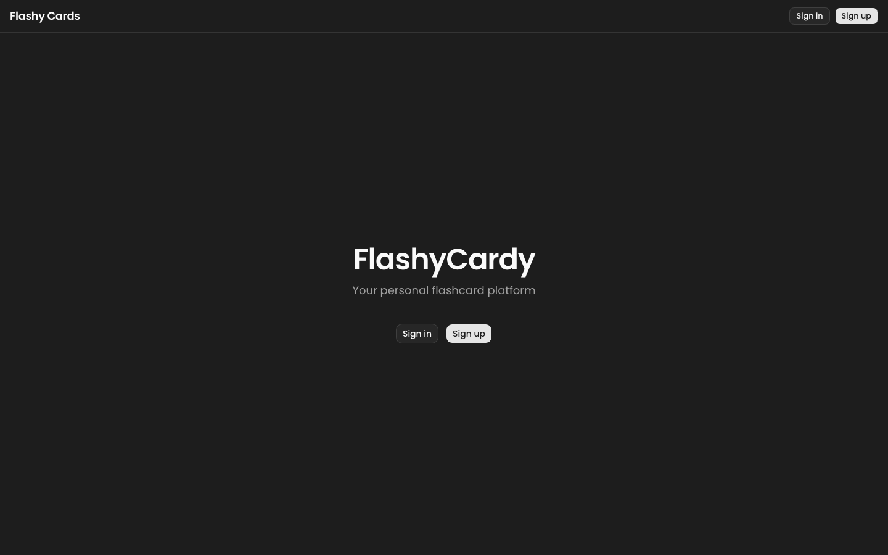
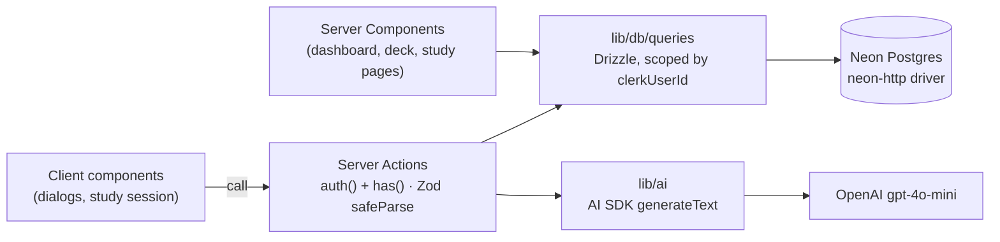

# Flashy Cards

A full-stack flashcard app with AI-generated decks, study sessions and subscription-based plan gating.


**[Live demo](https://flashy-cards-kappa.vercel.app)** · [Author's CV](https://udot-a.github.io/front-end-developer-cv/)



## Overview

Flashy Cards lets signed-in users build decks of question/answer cards, study them with a flip-card session, and generate a full deck of cards from a topic description using OpenAI. It is built on the Next.js 16 App Router: Server Components read data, Server Actions handle every mutation, and each query is scoped to the Clerk user who owns the data. Free and paid tiers are enforced through Clerk Billing on both the UI and the server.

## Features

- **Authentication** with Clerk: modal sign-in / sign-up, user menu, `clerkMiddleware` in `proxy.ts`; `/dashboard` is protected on the server and redirects on client-side sign-out.
- **Deck management**: create, edit and delete decks (title up to 200 chars, optional description up to 2000), listed by last update. Deleting a deck cascades to its cards.
- **Card management**: add, edit and delete cards (front/back up to 5000 chars each), with confirmation dialogs for destructive actions.
- **Study mode**: 3D flip cards, previous/next navigation, keyboard shortcuts (`←` `→` `Space`), shuffle, progress bar, correct/incorrect grading, an end-of-session score, and a re-study round with only the cards you missed.
- **AI card generation**: one click creates 20 cards from the deck's title and description using the Vercel AI SDK with a Zod-validated structured output, then bulk-inserts them.
- **Plan gating via Clerk Billing**: the free plan is capped at 3 decks; the `unlimited_decks` feature removes the cap, and AI generation requires the `pro` plan or the `ai_flashcard_generation` feature. Locked actions link to a `/pricing` page rendered with Clerk's `<PricingTable />`.
- **Per-user data isolation**: every query filters by the Clerk `userId`; cards are only reachable through a deck the user owns.
- **Shared validation**: the same Zod schemas drive React Hook Form on the client and `safeParse` in Server Actions, with toast feedback via Sonner.

## Tech stack

| Area | Tools |
| --- | --- |
| Framework | Next.js 16 (App Router, Server Components, Server Actions), React 19, TypeScript |
| UI | Tailwind CSS 4, shadcn/ui (Radix UI), lucide-react, Sonner |
| Forms & validation | React Hook Form, Zod 4 |
| Auth & billing | Clerk (`@clerk/nextjs`, Clerk Billing) |
| Database | Neon serverless Postgres, Drizzle ORM, Drizzle Kit |
| AI | Vercel AI SDK (`generateText` + `Output.object`), OpenAI `gpt-4o-mini` |
| Hosting | Vercel |

## Architecture



1. `proxy.ts` runs Clerk middleware on every request; pages and actions call `auth()` to get the `userId`.
2. Server Components load decks and cards through query helpers in `lib/db/queries`, all filtered by the owner's Clerk ID.
3. Client components call Server Actions, which check auth and plan entitlements (`has()`), validate input with Zod, write through Drizzle, and return a typed `{ ok, message }` result. The client then shows a toast and calls `router.refresh()`.
4. For AI generation, the action loads the owned deck, asks OpenAI for exactly 20 `{ front, back }` pairs, and inserts them in one batch.

```text
app/
  page.tsx                  Landing page (redirects signed-in users)
  pricing/page.tsx          Clerk <PricingTable />
  dashboard/                Deck list + create/delete deck actions
    decks/[deckId]/         Deck detail, card dialogs, deck/card/AI actions
      study/                Client-side study session
components/ui/              shadcn/ui primitives
components/form/            React Hook Form field wrappers
interfaces/                 Shared TypeScript types
lib/
  ai/                       AI flashcard generation
  db/                       Drizzle client, schema, user-scoped queries
  validation/               Zod schemas shared by client and server
  billing.ts                Free-plan deck limit
drizzle/                    Generated SQL migrations
proxy.ts                    Clerk middleware
```

**Database schema**

| Table | Columns |
| --- | --- |
| `decks` | `id` (identity PK), `clerk_user_id` (indexed), `title`, `description` (nullable), `created_at`, `updated_at` |
| `cards` | `id` (identity PK), `deck_id` (FK to `decks.id`, `ON DELETE CASCADE`, indexed), `front`, `back`, `created_at`, `updated_at` |

## Getting started

**Prerequisites:** Node.js 20.9+, a [Clerk](https://clerk.com) application (with Billing enabled for plan gating), a [Neon](https://neon.tech) Postgres database, and an OpenAI API key.

```bash
git clone https://github.com/udot-a/flashy-cards.git
cd flashy-cards
npm install
```

Create a `.env.local` file in the project root with the following variables:

| Variable | Used by |
| --- | --- |
| `DATABASE_URL` | Neon connection string (app and Drizzle Kit) |
| `NEXT_PUBLIC_CLERK_PUBLISHABLE_KEY` | Clerk (client) |
| `CLERK_SECRET_KEY` | Clerk (server) |
| `OPENAI_API_KEY` | `@ai-sdk/openai` |

In the Clerk Dashboard, create a `pro` plan and the features `unlimited_decks` and `ai_flashcard_generation` so the gating checks resolve.

Set up the database and start the dev server:

```bash
npm run db:migrate   # apply migrations from ./drizzle (or `npm run db:push` to sync the schema directly)
npm run dev          # http://localhost:3000
```

After changing `lib/db/schema.ts`, run `npm run db:generate` to create a new migration.

## Scripts

| Script | Command | Description |
| --- | --- | --- |
| `dev` | `next dev` | Start the development server |
| `build` | `next build` | Create a production build |
| `start` | `next start` | Serve the production build |
| `lint` | `eslint` | Lint the project |
| `db:generate` | `drizzle-kit generate` | Generate SQL migrations from the schema |
| `db:migrate` | `drizzle-kit migrate` | Apply pending migrations |
| `db:push` | `drizzle-kit push` | Push the schema directly to the database |
| `db:studio` | `drizzle-kit studio` | Open Drizzle Studio |

---

Built by **Andrii Udot** — [CV](https://udot-a.github.io/front-end-developer-cv/) · [LinkedIn](https://www.linkedin.com/in/andrii-udot-09181519a)
